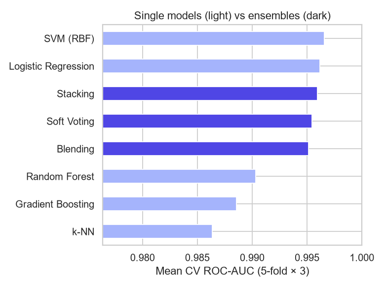

# Breast Cancer Ensemble Classifier

Classifies a breast tumour as benign or malignant from 10 measurements of cell nuclei in a biopsy image, and compares single models with voting, blending and stacking ensembles.

**[Live demo →](https://ravshanovna-breast-cancer.vercel.app)** — enter (or load) a tumour's measurements and get the stacked ensemble's probability of malignancy. The model runs in your browser (ONNX Runtime Web), no server needed.

> Educational project — **not medical advice** and not a diagnostic tool.



## Results

Stacking ensemble (5 base models + logistic-regression meta-model) on the held-out test set (20%, 114 tumours, 42 malignant):

| Metric | Score |
|---|---|
| ROC-AUC | **0.996** |
| Accuracy | 97.4% |
| Recall (malignant) | 92.9% |
| Precision (malignant) | 100% |
| F1 | 0.963 |

5-fold cross-validation repeated 3 times on the training set (10 selected features):

| Approach | ROC-AUC | F1 | Recall (malignant) |
|---|---|---|---|
| SVM (RBF) | 0.997 | 0.964 | 94.7% |
| Logistic Regression | 0.996 | 0.962 | 93.9% |
| **Stacking** (shipped) | 0.996 | 0.962 | **94.9%** |
| Soft Voting | 0.995 | 0.956 | 92.7% |
| Blending | 0.995 | 0.958 | 93.1% |
| Random Forest | 0.990 | 0.925 | 90.8% |
| Gradient Boosting | 0.989 | 0.930 | 91.4% |
| k-NN | 0.986 | 0.949 | 92.2% |

Honest takeaway: the classes are so well separated that a single linear model is already near-perfect, and all three ensembles land within cross-validation noise of it. Stacking is shipped because it has the best malignant recall in CV and is robust to any single model's weakness — and because comparing ensembles is the point of this project.

## Key findings

- **Ensembles need diversity**: linear models (LR, SVM) and tree models disagree the most, which is what a meta-model can exploit.
- **Stacking > blending on small data**: stacking learns its combination from out-of-fold predictions on all training rows; blending sacrifices 25% of the data for a hold-out set.
- **10 measurements are enough**: forward feature selection keeps essentially all of the 30-feature accuracy, which makes a usable form.
- On the test set the model raised **no false alarms** and missed 3 of 42 malignant tumours at the default 0.5 threshold. Those 3 get confidently low scores, so even a 0.2 threshold does not catch them — a clear reminder that a model like this can only support, never replace, a clinician.

## Approach

1. **Data** — Wisconsin Diagnostic Breast Cancer (569 tumours, 30 features); target flipped so that **malignant = positive class**.
2. **Split** — stratified 80/20 train/test; the test set is used once at the end.
3. **Feature selection** — forward selection with logistic regression (CV ROC-AUC) on the training set only → 10 features.
4. **Models** — Logistic Regression, SVM (RBF), k-NN, Random Forest, Gradient Boosting; ensembles: soft voting, blending (custom scikit-learn estimator) and `StackingClassifier`.
5. **Evaluation** — repeated stratified CV (5 × 3) for model comparison, then ROC-AUC, recall, precision, confusion matrix on the test set.
6. **Deployment** — the full `StandardScaler → StackingClassifier` pipeline is exported to ONNX and verified against scikit-learn.

## Project structure

```
├── notebook.ipynb     # EDA, base models vs voting vs stacking vs blending (with outputs)
├── train.py           # reproducible training + ONNX export
├── export_utils.py    # ONNX export / verification helpers
├── requirements.txt
└── web/               # static demo deployed on Vercel
    ├── index.html, app.js, style.css
    ├── model.onnx     # exported stacking pipeline
    ├── meta.json      # form schema, metrics, comparison
    └── assets/        # charts
```

## Run locally

```bash
pip install -r requirements.txt
python train.py                         # trains, evaluates, writes web/model.onnx
python -m http.server 8000 -d web       # open http://localhost:8000
```

## Tech

Python · pandas · scikit-learn (Stacking, Voting, custom Blending) · matplotlib/seaborn · skl2onnx · ONNX Runtime Web · Vercel

**Dataset:** [Breast Cancer Wisconsin (Diagnostic)](https://archive.ics.uci.edu/dataset/17/breast+cancer+wisconsin+diagnostic) (569 tumours, 30 features; bundled with scikit-learn as `load_breast_cancer`).
